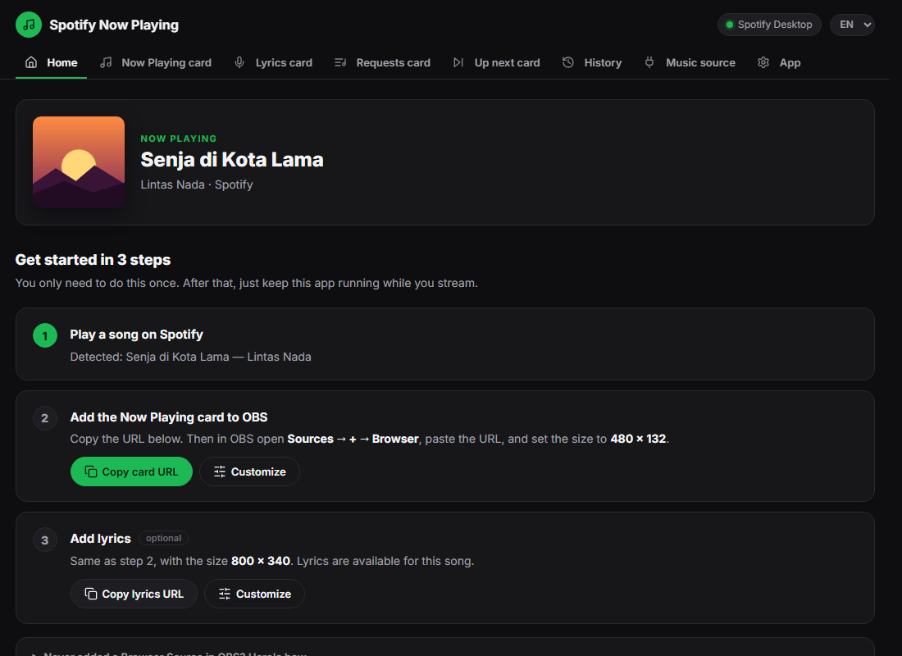

# Spotify Now Playing for OBS

**[Download the Windows installer](https://github.com/mohammadraflyy/spotify-now-playing/releases/latest)** · [Code signing policy](docs/CODE_SIGNING_POLICY.md) · [Privacy](#privacy) · [Bahasa Indonesia](README.md)

Shows the song you're playing on Spotify, with synced lyrics, as overlays in OBS.




## Features

- **Now playing card**: cover, title, artist and progress bar. Four layouts (row, vertical, minimal, vinyl). Show it all the time or only for a few seconds when the song changes, and create several styles for different scenes.
- **Lyrics overlay**: shown like in Spotify, with a background that follows the album cover's color. Lyrics come from [LRCLIB](https://lrclib.net) and are cached on your PC. Wrong lyrics can be replaced from the settings page, or with your own `.lrc` file.
- **Not just Spotify**: optionally reads YouTube Music, Apple Music, TIDAL and other players on the same PC.
- **Built-in chat bot**: viewers type `!song` in Twitch or YouTube chat and the bot replies with the song.
- **Text files and cover** for OBS Text/Image sources.
- **Song history** per day, exportable as `.txt` for VOD descriptions.
- **Runs in the system tray**. Settings are a page in your browser, in English or Indonesian.

## Getting started

1. Download `SpotifyNowPlaying-Setup-x.y.z.exe` from **[Releases](https://github.com/mohammadraflyy/spotify-now-playing/releases/latest)** and run it. No admin rights needed.
   - If Windows SmartScreen shows a warning, click **More info → Run anyway**.
   - Or with winget (pending Microsoft's review): `winget install mohammadrafly.SpotifyNowPlaying`
2. Open **Spotify Now Playing** from the Start Menu. It runs in the **system tray** (bottom right of the taskbar). Click the icon to open the settings, right-click for the menu.
3. The settings page opens on first run. Switch the language with **ID / EN** in the top right.
4. Play a song in Spotify Desktop, then follow the **3 steps** on the Home tab. Each step has a **Copy URL** button to paste into OBS.

### Adding an overlay to OBS

1. In OBS, go to **Sources → + → Browser**.
2. Paste the URL and set the size shown on the settings page:
   - Now playing card: `http://127.0.0.1:8765/overlay`
   - Lyrics: `http://127.0.0.1:8765/lyrics` (800 × 340)
3. Or drag the green box on the settings page straight into the OBS preview.

Changes on the settings page show up in OBS right away, without changing the URL.

### Music sources

| Mode | When to use it | Needs |
|---|---|---|
| **Local** *(easiest)* | Spotify plays on the same PC as OBS | Spotify Desktop open and playing. Check **Also read other players** for YouTube Music, Apple Music, TIDAL and more |
| **Spotify account** | Music plays on your phone, speakers or another PC | Your own Spotify developer app (Client ID) and a login. The app owner needs **Premium** |
| **Automatic** | Uses the account when possible, otherwise local | — |

### `!song` chat command

Open the **Chatbot** tab on the settings page. The bot answers commands in your live chat and replies on the platform the message came from, so it works on Twitch and YouTube at the same time. Default commands: `!song` (current song) and `!lastsong` (previous song, from the history). Commands, replies and the cooldown can be changed, and the **Try** box shows the reply without going live. You can also add **your own commands**, such as `!discord` or `!schedule`, with any reply. Replies can come from a **separate bot account**: on Twitch, connect the bot account and enter your channel; on YouTube, log in the bot as a second account.

| Platform | Setup |
|---|---|
| **Twitch** | Once: create an app in the [Twitch Developer Console](https://dev.twitch.tv/console/apps/create) (Category *Chat Bot*, Client Type *Public*) and paste its Client ID. Then click **Connect Twitch** and enter the code at `twitch.tv/activate`. |
| **YouTube** | Once: create a Google Cloud project, enable *YouTube Data API v3*, create an OAuth client of type *Desktop app*, and paste its Client ID and Client Secret. Then click **Log in with Google**. The bot starts reading chat when you go live. Because the free API quota is limited, chat is read every 10 seconds. While the Google app is in *Testing*, you need to log in again once a week. |
| **TikTok** | Not possible yet. TikTok has no official way for apps to read or reply to TikTok LIVE chat. TikTok viewers still see the song on the Now Playing card. |

**Already using another chatbot?** `http://127.0.0.1:8765/api/now.txt` returns the current song as text. Change the format with `?format={title} by {artist}`. Use it with a chatbot that runs on the same PC, such as Streamer.bot (**Core → Network → Fetch URL**) or Mix It Up. Cloud bots like Nightbot can't reach it.

### Card URL parameters

| Parameter | Effect |
|---|---|
| `layout=row\|vertical\|minimal\|vinyl` | card layout |
| `width=460` `height=112` `radius=16` | size and corners (px) |
| `bg=dark\|cover\|color\|none` `color=282828` `opacity=82` | background |
| `accent=1db954` | accent color |
| `hidePaused=1` `noProgress=1` `noCover=1` | hide while paused, hide progress bar, hide cover |
| `show=change` `showFor=8` | only show for 8 seconds when the song changes |
| `preset=gaming` | use a style created on the settings page |

## Files

| What | Where |
|---|---|
| App | `%LOCALAPPDATA%\Programs\Spotify Now Playing` |
| Settings and login | `%APPDATA%\SpotifyNowPlaying\config.json` (don't share it, it holds your login token) |
| Lyrics cache, history, log | `%APPDATA%\SpotifyNowPlaying\lyrics\`, `history\`, `app.log` |
| Text files and cover | `Documents\Spotify Now Playing` |

## Privacy

The app only connects to other services for features you use:

- **Lyrics**: the song's title, artist, album and duration are sent to [LRCLIB](https://lrclib.net).
- **Spotify account mode**: only if you enter a Client ID and log in.
- **Chat bot**: only if you turn it on and log in to Twitch or YouTube. The bot reads your own channel's chat and replies to commands.
- **New version notifications**: off by default. When enabled, the app checks GitHub releases once a day.

The song history stays on your PC. There is no telemetry or analytics. Details are in the [code signing policy](docs/CODE_SIGNING_POLICY.md#privacy-policy).

## Code signing policy

Free code signing provided by [SignPath.io](https://about.signpath.io), certificate by [SignPath Foundation](https://signpath.org).

Installers are built by GitHub Actions from the source in this repository, and every release is approved manually before signing. See [docs/CODE_SIGNING_POLICY.md](docs/CODE_SIGNING_POLICY.md).

## Development

```powershell
pip install -r requirements.txt
python -m spotify_now_playing --console               # run from source with console output
python -m unittest discover -s tests -t .             # unit tests
powershell -ExecutionPolicy Bypass -File build.ps1    # tests, then build exe and installer -> dist\
```

To release: bump `__version__` in `spotify_now_playing/__init__.py`, add `docs/release-notes/vX.Y.Z.md`, and push the tag `vX.Y.Z`. GitHub Actions builds the installer and publishes the release.

## License

[MIT](LICENSE). Third-party components: the [Inter](https://rsms.me/inter/) font (SIL Open Font License), [Lucide](https://lucide.dev) icons (ISC), and the Python libraries [pystray](https://github.com/moses-palmer/pystray) (LGPLv3) and [Pillow](https://python-pillow.org) (MIT-CMU).
