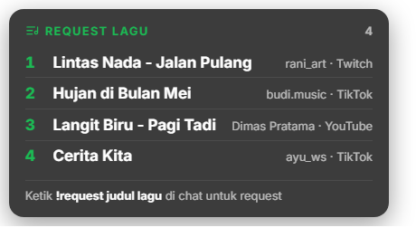

# Spotify Now Playing for OBS

**[Download the Windows installer](https://github.com/mohammadraflyy/spotify-now-playing/releases/latest)** · [Website](https://mohammadraflyy.github.io/spotify-now-playing/) · [Privacy](#privacy) · [Donate](https://trakteer.id/mohammadrafly/gift) · [Bahasa Indonesia](README.md)

Shows the song you're playing on Spotify, with synced lyrics, as overlays in OBS.




## Features

- **Now playing card**: cover, title, artist and progress bar. Four layouts (row, vertical, minimal, vinyl). Show it all the time or only for a few seconds when the song changes, and create several styles for different scenes.
- **Lyrics overlay**: shown like in Spotify, with a background that follows the album cover's color. Lyrics come from [LRCLIB](https://lrclib.net) and are cached on your PC. Wrong lyrics can be replaced from the settings page, or with your own `.lrc` file.
- **Not just Spotify**: optionally reads YouTube Music, Apple Music, TIDAL and other players on the same PC.
- **Song requests from viewers** through Twitch, YouTube and TikTok chat, with a queue and an OBS overlay. The app only reads chat and never sends messages.
- **During Spotify Free ads**: the overlay shows "Short break" and Spotify's sound is muted or lowered automatically, then set back when the ad ends. Ads are not skipped.
- **Text files and cover** for OBS Text/Image sources.
- **Song history** per day, exportable as `.txt` for VOD descriptions.
- **Runs in the system tray**. Settings are a page in your browser, in English or Indonesian.

## Getting started

1. Download `SpotifyNowPlaying-Setup-x.y.z.exe` from **[Releases](https://github.com/mohammadraflyy/spotify-now-playing/releases/latest)** and run it. No admin rights needed.
   - If Windows SmartScreen shows a warning, click **More info → Run anyway**.
2. Open **Spotify Now Playing** from the Start Menu. It runs in the **system tray** (bottom right of the taskbar). Click the icon to open the settings, right-click for the menu.
3. The settings page opens on first run. Switch the language with **ID / EN** in the top right.
4. Play a song in Spotify Desktop, then follow the **3 steps** on the Home tab. Each step has a **Copy URL** button to paste into OBS.

### Adding an overlay to OBS

1. In OBS, go to **Sources → + → Browser**.
2. Paste the URL and set the size shown on the settings page:
   - Now playing card: `http://127.0.0.1:8765/overlay`
   - Lyrics: `http://127.0.0.1:8765/lyrics` (800 × 340)
3. Or drag the green box on the settings page straight into the OBS preview.

Changes on the settings page show up in OBS right away, without changing the URL.

### Music sources

| Mode | When to use it | Needs |
|---|---|---|
| **Local** *(easiest)* | Spotify plays on the same PC as OBS | Spotify Desktop open and playing. Check **Also read other players** for YouTube Music, Apple Music, TIDAL and more |
| **Spotify account** | Music plays on your phone, speakers or another PC | Your own Spotify developer app (Client ID) and a login. The app owner needs **Premium** |
| **Automatic** | Uses the account when possible, otherwise local | — |

### `!song` for other chatbots

`http://127.0.0.1:8765/api/now.txt` returns the current song as text. Change the format with `?format={title} by {artist}`. Use it with a chatbot that runs on the same PC, such as Streamer.bot (**Core → Network → Fetch URL**) or Mix It Up. Cloud bots like Nightbot can't reach it.

### Song requests

Viewers type `!request song title` in chat, for example `!request Tulus - Pamit`. Requests go into the queue in the **Requests card** tab, and you play them yourself in Spotify. A request leaves the queue automatically when that song plays, or you can mark it as played.

The app only **listens** to chat and never sends messages, so there are no chat replies; viewers see their request on the overlay. Set up platforms under **Chats to listen to** in the same tab:

| Platform | Setup |
|---|---|
| **Twitch** | Enter your channel name. No login: Twitch chat is read anonymously. |
| **YouTube** | Once: create a Google Cloud project, enable *YouTube Data API v3*, create an OAuth client of type *Desktop app*, paste its Client ID and Client Secret, and click **Log in with Google** (read-only access). Chat is read automatically when you go live, every 10 seconds because the free API quota is limited. While the Google app is in *Testing*, you need to log in again once a week. |
| **TikTok** | Enter your TikTok username and a free API key from [Euler Stream](https://www.eulerstream.com), a third-party service that connects apps to TikTok LIVE chat. |

Also:
- **OBS overlay** `http://127.0.0.1:8765/requests` shows the queue on stream, so viewers (including TikTok) can see their request was added. Its look can be customized like the Now Playing card: width, text size, number of songs, corners, background (dark, fixed color, transparent), accent color, and whether to show the title, viewer names, platform and command hint. The OBS Browser Source size is calculated for you.

### Card URL parameters

| Parameter | Effect |
|---|---|
| `layout=row\|vertical\|minimal\|vinyl` | card layout |
| `width=460` `height=112` `radius=16` | size and corners (px) |
| `bg=dark\|cover\|color\|none` `color=282828` `opacity=82` | background |
| `accent=1db954` | accent color |
| `hidePaused=1` `noProgress=1` `noCover=1` | hide while paused, hide progress bar, hide cover |
| `show=change` `showFor=8` | only show for 8 seconds when the song changes |
| `preset=gaming` | use a style created on the settings page |

## Updates, backup and diagnostics

All in the **App** tab: **Update now** downloads and installs a new version in one click (the app restarts by itself). **Export** and **Import** move your card, lyrics, request overlay and chat settings to another PC, without logins or keys. **Copy diagnostic info** gives you a report to paste into [GitHub Issues](https://github.com/mohammadraflyy/spotify-now-playing/issues), with tokens and keys hidden. Settings are also backed up automatically, so a damaged `config.json` is restored from the last backup.

## Files

| What | Where |
|---|---|
| App | `%LOCALAPPDATA%\Programs\Spotify Now Playing` |
| Settings and login | `%APPDATA%\SpotifyNowPlaying\config.json`, backed up to `config.json.bak` (don't share it, it holds your login token) |
| Lyrics cache, history, log | `%APPDATA%\SpotifyNowPlaying\lyrics\`, `history\`, `app.log` |
| Text files and cover | `Documents\Spotify Now Playing` |

## Privacy

The app only connects to other services for features you use:

- **Lyrics**: the song's title, artist, album and duration are sent to [LRCLIB](https://lrclib.net).
- **Spotify account mode**: only if you enter a Client ID and log in.
- **Twitch chat listener**: only if you turn it on. The app reads the chat of the channel you enter, anonymously, without a login.
- **YouTube chat listener**: only if you turn it on and log in with Google (read-only access), to read your live chat.
- **TikTok listener**: only if you turn it on. Your TikTok username and API key are sent to Euler Stream to read your live chat.
- **New version notifications**: off by default. When enabled, the app checks GitHub releases once a day. The installer is only downloaded when you click **Update now**, and its SHA-256 checksum is verified before it runs.

The song history stays on your PC. There is no telemetry or analytics. Details are in the [privacy policy](docs/PRIVACY.md).

## Development

```powershell
pip install -r requirements.txt
python -m spotify_now_playing --console               # run from source with console output
python -m unittest discover -s tests -t .             # unit tests
powershell -ExecutionPolicy Bypass -File build.ps1    # tests, then build exe and installer -> dist\
```

To release: bump `__version__` in `spotify_now_playing/__init__.py`, add `docs/release-notes/vX.Y.Z.md`, and push the tag `vX.Y.Z`. GitHub Actions builds the installer and publishes the release.

## Support

The app is free and open source. If it helps you, you can support the developer on **[Trakteer](https://trakteer.id/mohammadrafly/gift)**. The donate button is also in the **App** tab and the tray menu.

## License

[MIT](LICENSE). Third-party components: the [Inter](https://rsms.me/inter/) font (SIL Open Font License), [Lucide](https://lucide.dev) icons (ISC), and the Python libraries [pystray](https://github.com/moses-palmer/pystray) (LGPLv3) and [Pillow](https://python-pillow.org) (MIT-CMU).
