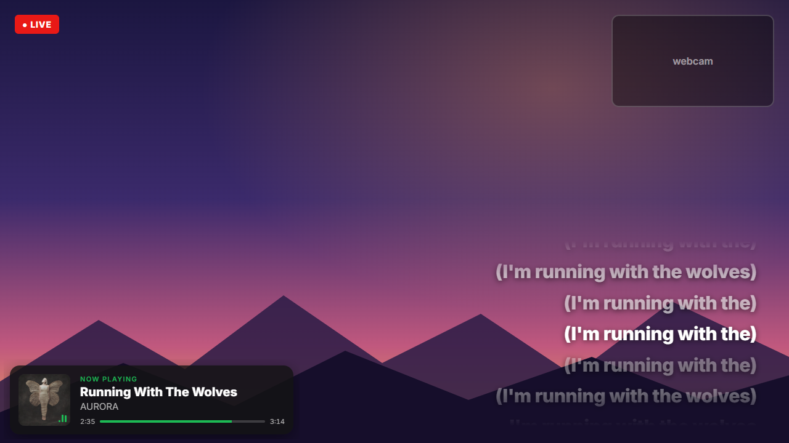
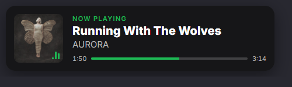
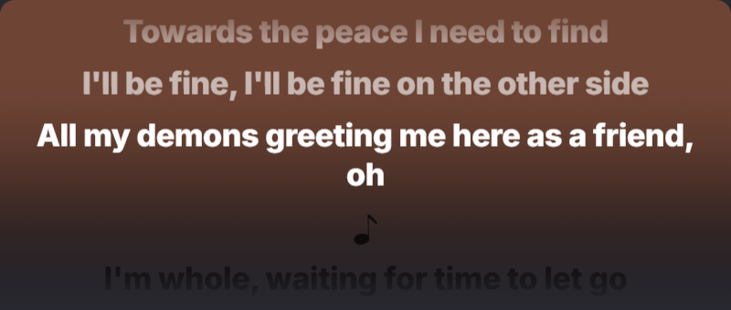
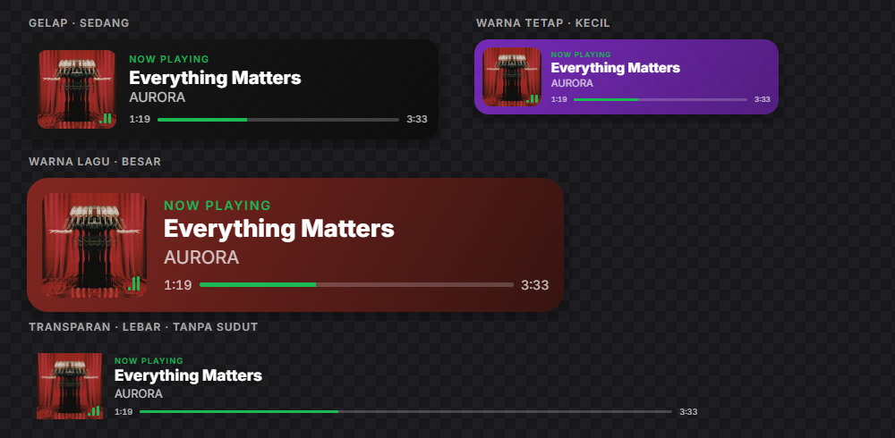
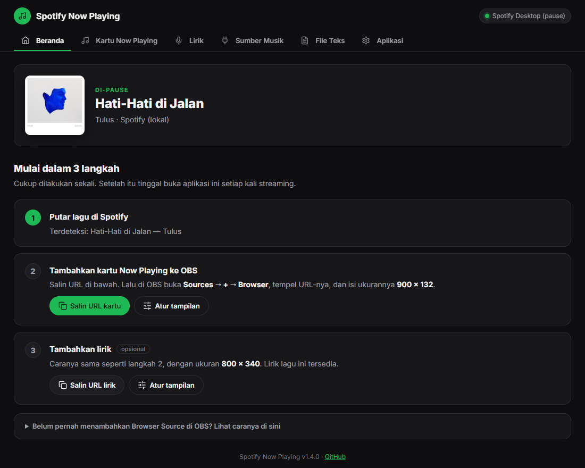
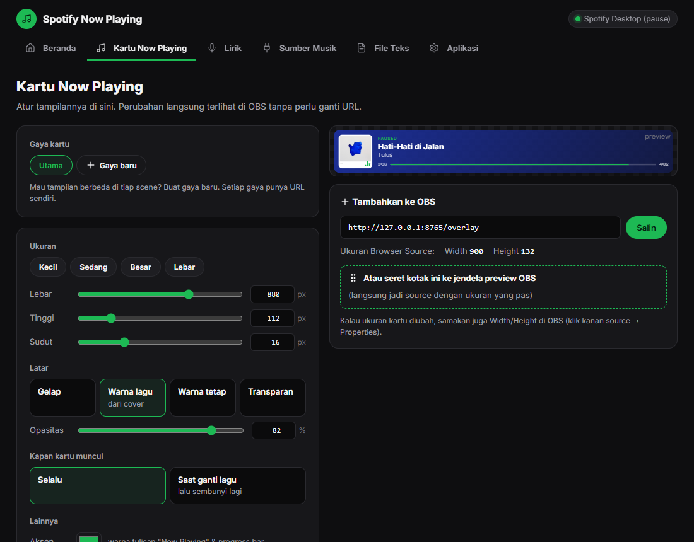
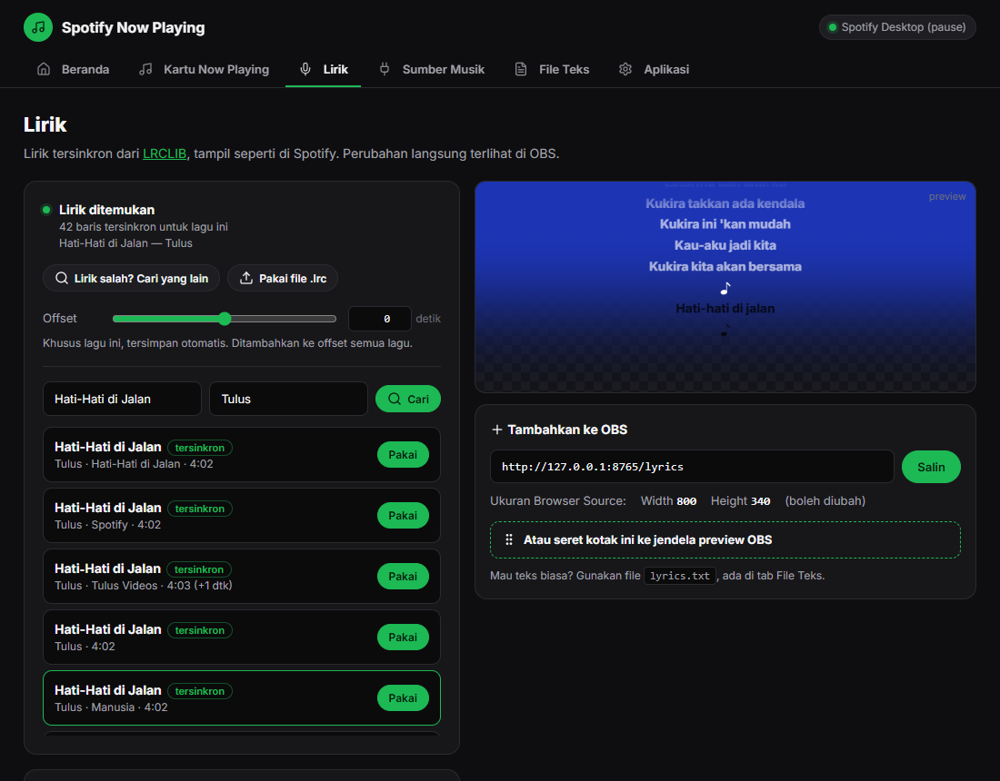

# Spotify Now Playing untuk OBS

**[Download installer (Windows)](https://github.com/mohammadraflyy/spotify-now-playing/releases/latest)** · [Code signing policy](docs/CODE_SIGNING_POLICY.md) · [Privasi](#privasi)

Menampilkan lagu yang sedang diputar dan lirik tersinkron dari Spotify di OBS.



## Screenshot

| Kartu Now Playing | Lirik: latar warna lagu |
|---|---|
|  |  |

**Kartu bisa diatur ukuran dan latarnya**



**Lirik mode satu baris**


**Halaman pengaturan** (`http://127.0.0.1:8765/settings`): panduan 3 langkah, dengan setiap pengaturan di tab terpisah dan preview langsung

| Beranda | Atur kartu |
|---|---|
|  |  |

**Lirik salah? Cari dan pilih yang benar, atau pakai file `.lrc` sendiri**



- **Overlay now playing**: cover, judul, artis, dan progress bar. Bisa tampil terus atau hanya beberapa detik setiap ganti lagu, dan bisa punya beberapa gaya untuk scene berbeda
- **Overlay lirik**: tampil seperti di Spotify, dengan latar mengikuti warna cover lagu. Liriknya dari [LRCLIB](https://lrclib.net), tersimpan di PC supaya tetap ada walaupun LRCLIB sedang down
- **Bukan cuma Spotify**: opsional, bisa juga membaca YouTube Music, Apple Music, TIDAL, dan player lain di PC yang sama
- **File teks dan cover** untuk OBS Text/Image source
- **Berjalan di system tray**, tanpa jendela console. Pengaturan lewat browser

---

## Cara pakai

### 1. Install dan jalankan

1. Download installer terbaru dari halaman **[Releases](https://github.com/mohammadraflyy/spotify-now-playing/releases/latest)**: file `SpotifyNowPlaying-Setup-x.y.z.exe` di bagian *Assets*. Lalu jalankan.
   - Kalau muncul peringatan Windows SmartScreen, klik **More info → Run anyway**.
   - Installer tidak butuh admin. Centang **Jalankan otomatis saat Windows menyala** kalau mau aplikasinya selalu siap.
2. Buka **Spotify Now Playing** dari Start Menu atau desktop. Aplikasinya berjalan di **system tray** (ikon hijau di pojok kanan bawah taskbar, mungkin tersembunyi di balik tanda panah `^`).
   - **Klik** ikonnya untuk membuka halaman pengaturan.
   - **Klik kanan** untuk menu: buka folder file teks, jalankan saat Windows menyala, dan keluar.
3. Aplikasi harus tetap berjalan selama streaming. Kalau dikeluarkan dari menu tray, overlay di OBS ikut hilang.
4. Pada pemakaian pertama, halaman pengaturan terbuka otomatis. Setelahnya, klik ikon tray, buka Start Menu → **Pengaturan (browser)**, atau ketik `http://127.0.0.1:8765/settings` di browser.
5. Di tab **Beranda**, ikuti **3 langkah** yang ditampilkan. Langkah yang sudah selesai otomatis tercentang, dan tombol **Salin URL** tinggal ditempel di OBS.

### 2. Pilih sumber data

Atur di halaman pengaturan, bagian **2. Akun & Sumber Data**.

| Mode | Kapan dipakai | Butuh |
|---|---|---|
| **Lokal** *(paling gampang)* | Spotify diputar di PC yang sama dengan OBS | Spotify Desktop terbuka dan sedang memutar lagu. Centang **Baca juga player lain** untuk YouTube Music, Apple Music, TIDAL, dan lainnya |
| **Akun Spotify** | Musik diputar dari HP, speaker, atau PC lain | Client ID dan login. Pemilik app harus **Premium** |
| **Otomatis** | Memakai akun kalau bisa, kalau tidak pindah ke Lokal | — |

> Mode **Lokal** langsung jalan tanpa setup apa pun. Lanjutkan ke langkah 3.

<details>
<summary><b>Setup mode Akun Spotify (opsional)</b></summary>

1. Buka https://developer.spotify.com/dashboard → **Create app**. Login dengan akun **Premium**.
2. Isi nama dan deskripsi app bebas, lalu centang **Web API**.
3. Di **Redirect URIs**, isi persis `http://127.0.0.1:8765/callback` → **Add** → **Save**.
4. Buka **Settings → User Management**, lalu tambahkan nama dan email akun Spotify kamu.
5. Copy **Client ID**, paste ke halaman pengaturan bagian **1. Spotify App**, lalu klik **Simpan**. Client Secret boleh dikosongkan.
6. Klik **Login dengan Spotify**, lalu **Agree**.

Kalau muncul error:

| Error | Solusi |
|---|---|
| `redirect_uri: Not matching configuration` | Redirect URI di dashboard belum persis `http://127.0.0.1:8765/callback`, atau belum di-**Save** |
| `403 user is not registered` | Tambahkan email kamu di **User Management** |
| `403 premium subscription required for the owner` | Akun pembuat app di dashboard bukan Premium, atau statusnya belum terbaca oleh Spotify (tunggu beberapa jam) |

</details>

### 3. Tambahkan ke OBS

#### a. Overlay Now Playing (kartu lagu)

**Cara cepat:** buka halaman pengaturan, lalu **seret kotak hijau** di bagian *3. Tambahkan ke OBS* ke jendela preview OBS.

**Cara manual:**
1. Di OBS, buka panel **Sources** → klik **+** → **Browser**.
2. Beri nama, misalnya `Spotify Now Playing` → OK.
3. Isi:
   - **URL**: `http://127.0.0.1:8765/overlay`
   - **Width** dan **Height**: ikuti angka yang tertera di halaman pengaturan. Untuk ukuran default, `480` × `132`.
4. Klik **OK**, lalu atur posisinya di scene.

**Atur tampilan kartu** di halaman pengaturan, bagian **3. Tambahkan ke OBS**. Perubahannya langsung terlihat di OBS tanpa ganti URL:
- **Ukuran**:
  - Preset: *Kecil*, *Sedang*, *Besar*, *Lebar*
  - Atau atur sendiri **lebar**, **tinggi**, dan **sudut lengkung**, lewat slider atau dengan mengetik angka px secara manual. Cover dan teks ikut menyesuaikan tinggi kartu.
- **Latar**:
  - *Gelap*
  - *Warna lagu*: diambil otomatis dari cover
  - *Warna tetap*
  - *Transparan*
  - Ditambah pengaturan **opasitas**
- **Kapan kartu muncul**: *Selalu*, atau *Saat ganti lagu*. Mode kedua menampilkan kartu beberapa detik (bisa diatur) setiap lagu berganti atau diputar lagi setelah pause, lalu menyembunyikannya
- **Lainnya**: warna aksen, sembunyikan saat pause, tanpa progress bar, dan tanpa cover

**Beberapa gaya kartu.** Di bagian **Gaya kartu**, klik **Gaya baru** untuk membuat tampilan lain, misalnya `gaming` atau `chill`. Setiap gaya punya URL sendiri, misalnya `http://127.0.0.1:8765/overlay?preset=gaming`, jadi tiap scene OBS bisa memakai gaya yang berbeda.

> Setelah mengubah ukuran kartu, sesuaikan juga Width/Height Browser Source di OBS (klik kanan → Properties) dengan angka yang tertera di halaman pengaturan.

Semua opsi juga bisa ditimpa lewat parameter URL, misalnya untuk beberapa scene dengan gaya berbeda:

| Parameter | Fungsi |
|---|---|
| `width=460` `height=112` | ukuran kartu (px) |
| `radius=16` | sudut lengkung (px) |
| `bg=dark\|cover\|color\|none` | jenis latar |
| `color=282828` | warna latar untuk `bg=color` (hex tanpa `#`) |
| `opacity=82` | opasitas latar (0–100) |
| `accent=1db954` | warna aksen |
| `hidePaused=1` `noProgress=1` `noCover=1` | sembunyikan kartu saat pause, sembunyikan progress bar, sembunyikan cover |
| `show=change` `showFor=8` | tampilkan kartu hanya saat ganti lagu, selama 8 detik |
| `preset=gaming` | pakai gaya kartu yang dibuat di halaman pengaturan |

Contoh: `http://127.0.0.1:8765/overlay?bg=cover&width=600&height=150`

#### b. Overlay Lirik (seperti di Spotify)

1. OBS → **Sources** → **+** → **Browser** → beri nama `Spotify Lyrics`.
2. Isi **URL** `http://127.0.0.1:8765/lyrics`, **Width** `800`, **Height** `300` → OK.
3. Atur tampilannya di halaman pengaturan bagian **4. Lirik ke OBS**. Perubahannya langsung terlihat di OBS tanpa ganti URL:
   - **Gaya**: *Daftar bergulir* (beberapa baris) atau *Satu baris* (pakai Height sekitar `120`)
   - **Latar**:
     - *Warna lagu*: diambil otomatis dari cover album. Bagian bawahnya menggelap lalu memudar halus menjadi transparan, sehingga menyatu dengan latar scene
     - *Warna tetap*: warna pilihan kamu
     - *Gelap*
     - *Transparan*: hanya teks
   - **Ukuran** dan **rata teks**
   - Baris yang sedang dinyanyikan berwarna putih, yang sudah lewat putih redup, dan yang berikutnya gelap
   - **Offset waktu**: geser ke **+** kalau lirik telat, ke **−** kalau terlalu cepat

Tidak semua lagu punya lirik tersinkron. Status lirik untuk lagu yang sedang diputar ditampilkan di halaman pengaturan, di tab **Lirik**. Di sana juga ada:
- **Lirik salah? Cari yang lain**: cari di LRCLIB dengan judul dan artis yang bisa diubah, lalu klik **Pakai**. Hasil yang durasinya paling cocok ditampilkan paling atas.
- **Pakai file .lrc**: pakai lirik tersinkron milikmu sendiri.
- **Offset khusus lagu ini**, untuk lagu yang liriknya telat atau terlalu cepat sendiri.

Semua pilihan ini tersimpan per lagu dan otomatis dipakai lagi saat lagu itu diputar. **Kembali ke otomatis** menghapusnya.

#### c. Teks dan cover biasa (opsional)

Semua file ada di `Documents\Spotify Now Playing`. Tombol **Buka folder** ada di halaman pengaturan bagian 5.

| File | Isi | Source OBS |
|---|---|---|
| `nowplaying.txt` | `Artis - Judul` (format bisa diubah) | **Text (GDI+)** → centang *Read from file* |
| `title.txt` / `artist.txt` / `album.txt` | judul / artis / album | Text (GDI+) |
| `progress.txt` | `1:23 / 3:45` | Text (GDI+) |
| `lyrics.txt` | baris lirik yang sedang dinyanyikan | Text (GDI+) |
| `cover.jpg` | cover album | **Image** |

> Tips: untuk teks berjalan, klik kanan source Text → **Filters** → **+** → **Scroll**.

### 4. Kalau overlay tidak muncul atau tidak berubah

1. Pastikan ikon **Spotify Now Playing** ada di system tray. Kalau tidak ada, buka lagi aplikasinya dari Start Menu.
2. Buka `http://127.0.0.1:8765/settings` dan lihat bagian **Status**. Kalau di sana lagunya muncul, berarti aplikasinya jalan.
3. Di OBS, klik kanan source Browser → **Properties** → **Refresh cache of current page**.
4. Untuk mode Lokal, lagu harus diputar di **Spotify Desktop di PC ini**, bukan di HP. Web player dan player lain hanya terbaca kalau **Baca juga player lain** dicentang.
5. Kalau masih bermasalah, lihat `app.log` di folder data (tab **Aplikasi** → **Buka folder**).

---

## Lokasi file

| Apa | Lokasi |
|---|---|
| Aplikasi | `%LOCALAPPDATA%\Programs\Spotify Now Playing` |
| Pengaturan dan login | `%APPDATA%\SpotifyNowPlaying\config.json`. Jangan dibagikan, karena berisi token login |
| Cache lirik dan log | `%APPDATA%\SpotifyNowPlaying\lyrics\` dan `app.log` |
| File teks dan cover | `Documents\Spotify Now Playing` |

Uninstall lewat **Settings → Apps → Spotify Now Playing**, atau Start Menu → *Uninstall Spotify Now Playing*.

---

## Development

```powershell
pip install -r requirements.txt
python -m spotify_now_playing                         # jalankan dari source (ikon tray)
python -m spotify_now_playing --console               # status di console, tanpa tray
python -m unittest discover -s tests -t .             # unit test
powershell -ExecutionPolicy Bypass -File build.ps1    # test, lalu build exe dan installer -> dist\
```

Build butuh Python 3.10+ dan [Inno Setup 6](https://jrsoftware.org/isinfo.php) (`winget install JRSoftware.InnoSetup`). Versi aplikasi diatur di `spotify_now_playing/__init__.py`.

Opsi command line: `--port 8766` untuk ganti port, `--no-browser` supaya halaman pengaturan tidak dibuka, `--console`, dan `--version`.

Setiap push ke `main` di-build oleh GitHub Actions (`.github/workflows/build.yml`), termasuk menjalankan unit test.

### Struktur

```
spotify_now_playing/
  __main__.py     entry point, single-instance, log
  tray.py         ikon dan menu system tray
  app.py          loop polling, state, file output
  spotify_api.py  OAuth (PKCE / secret) dan Web API
  local_media.py  Spotify / player lain lewat Windows Media Controls
  lyrics.py       lirik dari LRCLIB, cache di disk, perbaikan manual
  server.py       web server lokal dan API JSON
  updates.py      cek versi baru (opt-in)
  startup.py      jalankan saat Windows menyala
  config.py       lokasi file dan penyimpanan config
  web/            overlay.html, lyrics.html, settings.html, font Inter
tests/            unit test
installer.iss     script Inno Setup
build.ps1         test, build PyInstaller, dan installer
```

---

## Privasi

Aplikasi ini tidak mengirim data apa pun ke luar kecuali untuk fitur yang kamu pakai:

- **Lirik**: judul, artis, album, dan durasi lagu dikirim ke [LRCLIB](https://lrclib.net) untuk mencari liriknya.
- **Mode Akun Spotify**: hanya kalau kamu mengisi Client ID dan login. Aplikasi lalu terhubung ke server Spotify untuk membaca lagu yang sedang diputar.
- **Notifikasi versi baru**: mati secara default. Kalau dinyalakan di tab **Aplikasi**, aplikasi mengecek halaman rilis GitHub sehari sekali.

Tidak ada telemetri atau analitik. Font sudah disertakan di aplikasi, jadi overlay tidak memuat apa pun dari Google Fonts. Web server lokal hanya bisa diakses dari PC ini (`127.0.0.1`). Detail lengkapnya ada di [Code signing policy](docs/CODE_SIGNING_POLICY.md#privacy-policy).

## Code signing policy

Free code signing provided by [SignPath.io](https://about.signpath.io), certificate by [SignPath Foundation](https://signpath.org).

Installer dibuild otomatis oleh GitHub Actions dari source di repo ini, dan setiap rilis disetujui manual sebelum ditandatangani. Penjelasan proses build, peran tim, dan kebijakan privasi ada di **[docs/CODE_SIGNING_POLICY.md](docs/CODE_SIGNING_POLICY.md)**.

| Peran | Anggota |
|---|---|
| Committer dan reviewer | [mohammadraflyy](https://github.com/mohammadraflyy) |
| Approver | [mohammadraflyy](https://github.com/mohammadraflyy) |

## Lisensi

[MIT](LICENSE). Komponen pihak ketiga: font [Inter](https://rsms.me/inter/) (SIL Open Font License, `spotify_now_playing/web/fonts/OFL.txt`), ikon [Lucide](https://lucide.dev) (ISC), dan library Python [pystray](https://github.com/moses-palmer/pystray) (LGPLv3) serta [Pillow](https://python-pillow.org) (MIT-CMU).
